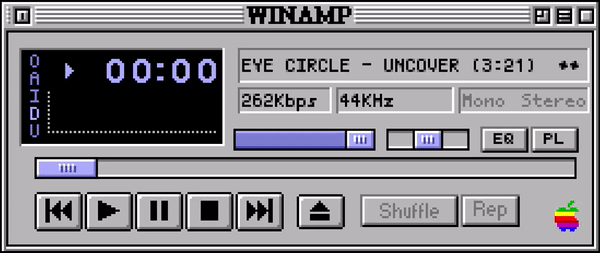
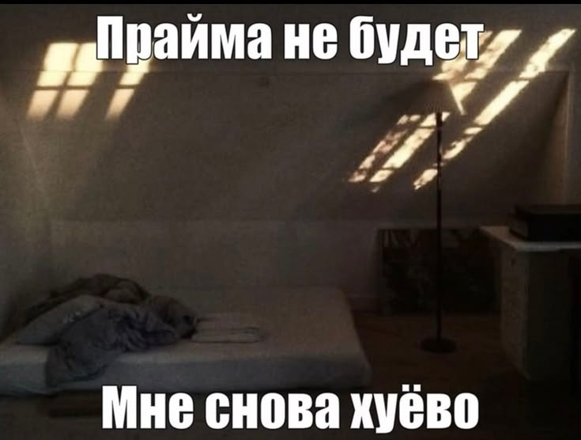

# LyricsApp

<p align="center">
  
</p>

Оверлей с синхронизированными строками песни для Windows. Берёт текущий трек и позицию
из системного медиа-центра (SMTC), поэтому работает с AIMP, Spotify, VK, Telegram и любым
другим плеером, который отдаёт данные в Windows.

##

<p align="center">
  
</p>

<p align="center">
  
</p>

## Возможности

- Караоке-подсветка строки по мере пения.
- **Появление текста** выбирается во вкладке «Режимы»
  - **«Обычная строка»** — строка появляется целиком и подсвечивается по мере пения.
  - **«Слова по одному»** — как в Reels-Instagram: слова идут вертикальным столбиком
    сверху вниз и всплывают по одному — с лёгким «пружинным» увеличением и короткой
    белой вспышкой; цвет берётся из настроек градиент или «Цвет спетого», по умолчанию
    белый, ещё не спетые остаются серыми или скрыты.
    Настраивается: сколько слов в строке 1–4 и сколько строк видно одновременно 1–8.
  - **«Текст из пластинки»** — строка вытягивается из края пластинки, а затем
    сдвигается на своё место. Под текстом тянется ровная светящаяся нить, которая
    тает, когда строка допета; в режиме «Классика» она идёт от левого края.
  - **«Слова по сторонам»** — слова по мере пения появляются в случайных местах:
    сверху, в середине, снизу слева или снизу справа, — и вылетают слева, справа
    или сверху; никаких фиксированных колонок и одинаковых строк. Размер слов
    слегка случайный, поэтому строка выглядит хаотично и живо. Окно оверлея в этом
    режиме становится заметно выше и расширяется вниз, чтобы словам хватало места
    и внизу экрана. Неспетые слова не показываются, «Цвет неспетого» в этом режиме
    не используется. Полностью спетая строка держится мгновение и исчезает — экран
    остаётся чистым до следующей строки. В режиме «Винил» пластинка лежит внизу
    по центру, а слова летят вокруг неё, не задевая диск; диск всегда виден
    целиком, без обрезки краем окна.
- **Режим показа** «Классика» — 1–7 строк «столбиком» текущая строка по центру,
  предыдущие сверху приглушённо, следующие снизу. «Винил» — вращающаяся пластинка
  с обложкой альбома, текст рядом; под диском — название трека и исполнитель.
  Диск оформлен неоновым стилем: тёмный винил, цветные блики и электрические
  полосы, которые вращаются вместе с ним при смене строки по диску проходит
  световое кольцо.
- **Настройка пластинки** стиль диска «Неон», «Классика», «Минимал»,
  неоновый цвет, сила свечения, светящийся ободок, скорость вращения, размер,
  отступ до текста, сдвиг влево-вправо и подпись под диском.
- **Темы меню**: стандартная, тёмная, светлая, прозрачная. Меняют вид окон
  настроек и редактора текста, не трогая цвета текста на оверлее.
  «Светлая» — полностью белое окно, «прозрачная» — тёмное полупрозрачное стекло,
  сквозь которое немного виден рабочий стол. Переключение темы просто перекрашивает
  открытые окна, без «наложения» старых.
  Все элементы меню следуют теме: крестик закрытия, чекбоксы с галочкой, стрелки
  выпадающих списков, кнопки-«+/-» у числовых полей и компактные цветовые плашки
  «Выбрать» сам цвет — фон плашки, HEX — в подсказке без широких полос на всю строку.
- **Анимированные статусы**: «Поиск текста…» — спиннер и бегущие точки,
  «Текст не найден» — янтарная пульсация, «Ошибка текста/синхронизации» — красным;
  подсказка «≈ текст без синхронизации» тоже выделена красным.
- **Синхронизация с плеером**: позиция берётся из SMTC и уточняется по времени
  последнего обновления, поэтому текст не отстаёт на несколько секунд. Смена трека
  и перемотка подхватываются сразу, даже если плеер «заморозил» счётчик; название
  трека ждёт подтверждения около секунды — вкладки браузера иногда «мигают» между
  двумя треками.
- Направление появления текста: снизу, сверху, слева, справа или без сдвига,
  с настраиваемой дистанцией.
- Обводка, свечение, градиент (от 2 до 6 цветов), пульсация, «волна» по буквам, мерцание.
- Прозрачный фон (или свой цвет с прозрачностью), перетаскивание мышью.
- Плавные 60 fps: слова всплывают по времени, а не по «шагам» подсветки;
  свечение — настоящее размытие (без жёстких колец), считается один раз на слово/строку
  и кэшируется, поэтому анимация не проседает.
- Шрифты и их метрики кэшируются: даже с сотнями установленных шрифтов оверлей
  не тратит время на повторный поиск шрифта в каждом кадре.
- Поиск текста: локальный кэш `cache/lyrics` → LRCLIB с таймингами → Genius
  без таймингов, примерная разбивка.
- **Ручной текст и тайминги**: если текст не нашёлся — вставьте его сами и отметьте
  начало каждой строки Пробелом (или разметьте равномерно и поправьте время).
  Сохраняется локально и подхватывается при следующем запуске трека.
  Текст без таймингов показывается всегда, с примерной разбивкой по длительности трека.
  Подпись «≈ текст без синхронизации (примерный тайминг)» мигает примерно 35 секунд,
  после чего исчезает; её можно убрать сразу крестиком в правом нижнем углу. В «Прочее»
  подпись можно отключить совсем — сам текст при этом остаётся на экране.
- Обложка: из тегов файла через SMTC, а если её нет — поиск в iTunes - Deezer
  и локальный кэш в `cache/covers`.
- Запуск без окна консоли `LyricsApp.vbs` / `LyricsApp.bat` и автозапуск с Windows.

## Установка

**Обычный пользователь:** запустите **`LyricsApp-Setup.exe`** (лежит в папке `dist`).
Установщик не требует прав администратора и сам делает всё нужное:

- ставит приложение в `%LOCALAPPDATA%\LyricsApp`
- находит 64-битный Python 3.10+, а если его нет — скачивает и тихо ставит Python 3.13;
- создаёт отдельное окружение `venv` и устанавливает в него все библиотеки из
  `requirements.txt` PyQt6, winrt, requests, PySocks, lyricsgenius
- создаёт ярлыки на рабочем столе и в меню «Пуск», добавляет запись
  в «Приложения и возможности».

Повторный запуск установщика обновляет файлы и библиотеки, сохраняя настройки и кеш
текстов. Удалить приложение можно через «Удалить LyricsApp» в меню «Пуск» или через
«Параметры → Приложения».

**Для разработки** можно поставить зависимости в текущий Python:

```powershell
pip install -r requirements.txt
```

Запуск двойным кликом по **`LyricsApp.vbs`** совсем без консоли или **`LyricsApp.bat`**.
Оба ищут `pythonw.exe`: сначала в `%LOCALAPPDATA%\Programs\Python\Python314`, затем в `PATH`,
и показывают понятное сообщение, если Python не найден. Повторный запуск не создаёт второй
оверлей — приложение просто выходит. Для отладки можно по-прежнему `python start.py`.

Нужен Python 3.10+ (проверено на 3.14) и Windows 10/11.

Пересобрать установщик после изменений: `python build_installer.py` (нужен `pyinstaller`).
Готовый файл появится в `dist/LyricsApp-Setup.exe`.

Если winrt-пакеты стоят разных версий и появляется `AttributeError: module 'winrt._winrt'
has no attribute '_C_API'`, обновите весь набор сразу:

```powershell
pip install --upgrade winrt-runtime winrt-Windows.Foundation winrt-Windows.Foundation.Collections winrt-Windows.Media.Control winrt-Windows.Storage.Streams
```

Если в системе настроен SOCKS-прокси, `requests` без пакета `PySocks` не может через него
ходить (в лог пишется `Missing dependencies for SOCKS support`). `PySocks` уже входит в
`requirements.txt`; при ручном обновлении: `pip install "requests[socks]"`.
Если прокси недоступен, приложение само пробует прямое подключение и пишет об этом одну
строку в лог, а не трассировку на каждый запрос.

## Управление

- **ЛКМ + перетаскивание** — переместить оверлей.
- **ПКМ** — открыть настройки.
- **Иконка в трее** — показать-скрыть оверлей, настройки, ручной текст, выход.

## Настройки

Файл `lyrics_settings.json` создаётся рядом со `start.py`. Основное:

| Ключ | Что делает |
| --- | --- |
| `mode` | `classic` или `vinyl` |
| `theme` | тема меню: `custom`, `dark`, `light`, `transparent` |
| `anim_mode` | `line` («Обычная строка»), `words` («Слова по одному»), `pull` («Текст из пластинки») или `sides` («Слова по сторонам») |
| `words_per_row`, `words_visible` | слов в строке (1–4) и строк в столбике (1–8) |
| `slide_from`, `slide_dist` | откуда и как далеко «въезжает» строка/слово |
| `lines_visible` | сколько строк видно одновременно (1–7) |
| `text_width` | ширина текстового блока в % от окна |
| `vinyl_size`, `vinyl_gap` | диаметр пластинки и отступ до текста |
| `vinyl_shift`, `vinyl_caption` | сдвиг диска по горизонтали и подпись под ним |
| `vinyl_style` | стиль диска: `neon`, `classic` или `minimal` |
| `vinyl_accent` | неоновый цвет диска (свечение, полосы, ободок) |
| `vinyl_glow`, `vinyl_rim` | сила свечения 0–100 и светящийся ободок |
| `vinyl_speed` | скорость вращения пластинки |
| `cover_online` | искать обложку в интернете, если в тегах её нет |
| `autostart` | запускать вместе с Windows (файл в папке «Автозагрузка») |
| `offset`, `sync_margin` | подстройка синхронизации и скорости «допевания» строки |
| `show_unsynced_hint` | показывать подпись «текст без синхронизации» под текстом без таймингов (сам текст виден всегда) |
| `gradient_colors` | цвета градиента текста (2–6 значений, первым идёт основной цвет) |

## Файлы

- `start.py` — приложение (трекер SMTC, поиск текста и обложек, отрисовка, настройки).
- `LyricsApp.vbs` / `LyricsApp.bat` — запуск без окна консоли.
- `lyrics_utils.py` — разбор LRC, нормализация названий, сопоставление исполнителей.
- `installer.py` — установщик/удалятор (venv, Python, ярлыки, запись в «Приложения»).
- `build_installer.py` — сборка `dist\LyricsApp-Setup.exe` (payload + PyInstaller).
- `assets/LyricsApp.ico`, `assets/LyricsApp.png` — иконка приложения, окна и трея.
- `test_lyrics_utils.py` — тесты (`python -m unittest test_lyrics_utils.py`).
- `smtc_debug.py` — диагностика: что реально отдаёт плеер через SMTC.
- `cache/lyrics` — локальные LRC (найденные онлайн и размеченные вручную).
- `cache/covers` — кэш обложек.
